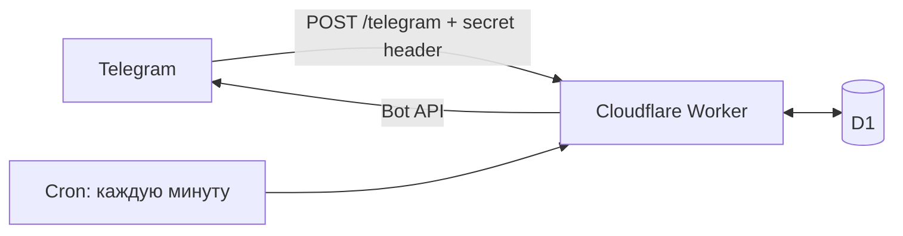

<div align="center">

# 🚭 НЕ КУРЮ · TgBotSmoke

**Личный прогресс отказа от сигарет — в Telegram, каждый день.**

[](https://t.me/ne_kuryu_progress_bot)
[](https://developers.cloudflare.com/workers/)
[](cloudflare/src/worker.js)
[](LICENSE)

Серии без курения, оценка экономии, сохранённые достижения и спокойная поддержка при тяге.

[Начать в Telegram](https://t.me/ne_kuryu_progress_bot) · [Разработка](#локальная-разработка) · [Развёртывание](#развёртывание-на-cloudflare) · [Источники](#научная-основа)

</div>

## Возможности

- **Персональный отсчёт.** Дата последней сигареты, текущая серия и суммарное время всех учтённых периодов.
- **Ежедневный отчёт.** Индивидуальные время и часовой пояс IANA, чередующиеся приветствия и мысли дня.
- **Оценки экономии.** Невыкуренные сигареты, деньги по валютам и время без перекуров на основе прежнего расхода.
- **Достижения.** 1, 3, 7, 14, 30, 60, 90, 180 и 365 дней непрерывной серии; полученные награды сохраняются.
- **История срывов.** Начало и последняя сигарета с подтверждением; промежуток курения исключается из итогов.
- **Календарь здоровья.** Ориентиры восстановления со ссылками на источники, без персональных медицинских прогнозов.
- **Поддержка при тяге.** Короткие практические действия в разделе «Хочу закурить».
- **Настройки и продолжение диалога.** Изменение параметров, сохранение незавершённой регистрации, отмена через `/cancel`.

Чтобы начать, откройте [@ne_kuryu_progress_bot](https://t.me/ne_kuryu_progress_bot), отправьте `/start` и ответьте на семь вопросов. Бот работает в личных чатах.

## Пример ежедневного отчёта

Сокращённый пример для 3 дней без курения при прежнем расходе 20 сигарет в день, цене 250 RUB за пачку из 20 сигарет и длительности перекура 5 минут. Приветствие и мысль зависят от дня и пользователя.

```text
🚭 НЕ КУРЮ · …
17.11.2026

🚭 Текущая серия: 3 дн. 0 ч. 0 мин.
📅 Всего в учтённых бездымных периодах: 3 дн. 0 ч. 0 мин.
🚬 Не выкурено, оценка: ≈ 60,00
💰 Сэкономлено, оценка: ≈ 750,00 RUB
⏳ Без перекуров: ≈ 0 дн. 5 ч. 0 мин.
❤️ Статистический эквивалент: ≈ 0 дн. 20 ч. 0 мин.
```

В полном отчёте также есть пояснение статистической модели, ориентир здоровья, ближайшая цель и мысль дня. Эквивалент времени жизни — популяционная оценка, **не обещание прожить дольше на указанное время**.

## Как работает персональная статистика

Для каждого бездымного периода расчёт выполняется отдельно:

| Показатель | Формула |
| --- | --- |
| Невыкуренные сигареты | Секунды периода × прежние сигареты в день / 86 400 |
| Экономия | Невыкуренные сигареты × цена пачки / сигареты в пачке |
| Время без перекуров | Невыкуренные сигареты × минуты на сигарету |
| Статистический эквивалент | Невыкуренные сигареты × 20 минут |

Результаты периодов суммируются. Валюты учитываются отдельно, без конвертации. При изменении расхода, цены или длительности пересчитывается текущая серия; завершённые серии сохраняют свои параметры. Исправление даты старта ограничено хронологией предыдущих серий.

Время хранится в UTC, ввод сравнивается с минутной точностью. Один день серии — 24 часа. Переходы часовых поясов не меняют фактическую длительность; неоднозначное местное время требует явного смещения UTC. Денежные расчёты используют Decimal с точностью 28 значащих цифр. Сигареты и деньги выводятся до двух знаков; модельные минуты сначала округляются до секунды, затем длительность отображается до полных минут.

## Научная основа

Календарь использует общие ориентиры из материалов организаций здравоохранения:

- [WHO — Health benefits of smoking cessation](https://www.who.int/news-room/questions-and-answers/item/tobacco-health-benefits-of-smoking-cessation): ранние изменения и последующие преимущества отказа.
- [CDC — Benefits of Quitting Smoking](https://www.cdc.gov/tobacco/about/benefits-of-quitting.html): снижение рисков и изменения в течение месяцев и лет.
- [NHS — Quit smoking](https://www.nhs.uk/better-health/quit-smoking/): восстановление после отказа и поддержка на разных этапах.
- [Jackson, Jarvis, West — The price of a cigarette: 20 minutes of life?, Addiction (2025)](https://doi.org/10.1111/add.16757): источник коэффициента 20 минут на сигарету.

Исходные медицинские тексты и ссылки находятся в [smoke/medical.py](smoke/medical.py); облачная версия получает их через экспорт в [assets.json](cloudflare/src/assets.json). Месяцы и годы в календаре приближены к 30 и 365 дням. Порог обозначает начало диапазона, а не гарантированное завершение процесса.

## Технологии

| Компонент | Используется для |
| --- | --- |
| JavaScript, ES modules | Облачный Worker и обработка команд |
| Cloudflare Workers, Web Fetch API | Telegram Webhook и вызовы Bot API |
| Cloudflare D1 | Профили, серии, достижения, диалоги и журнал отправок |
| Cron Triggers | Проверка индивидуальных расписаний каждую минуту |
| decimal.js | Десятичные расчёты |
| @js-temporal/polyfill | Часовые пояса, календарные даты и DST |
| Wrangler, npm | Сборка, локальная разработка и развёртывание |
| Python 3.12+, aiogram 3, SQLite, APScheduler | Исходная реализация, эталонные тесты и инструменты миграции |

Облачная версия написана на **JavaScript**. TypeScript в проекте не используется.

## Архитектура



Основной способ эксплуатации — Worker `tgbot-smoke` с отдельной D1 `tgbot-smoke-db`. После развёртывания компьютер владельца для работы бота не нужен. Текущий адрес Worker — `tgbot-smoke.rustik-yuldashev.workers.dev`; собственный домен пока не подключён.

Webhook проверяет `X-Telegram-Bot-Api-Secret-Token`. Идентификаторы обновлений и блокировки пользователей хранятся в D1; Telegram настроен на одно соединение. Cron проверяет местную дату и время, обрабатывает до трёх доставок за тик и резервирует уникальную пару «пользователь / местная дата» до отправки.

Успешные отправки не повторяются. Явный ответ Telegram 429 сохраняет паузу и допускает retry. При неизвестном результате доставки повтор не выполняется: возможен пропуск, зато неопределённость не приводит к дублю. Пропущенные прошлые дни не рассылаются. При блокировке бота отчёты отключаются до следующего `/start`.

Публичный `/health` показывает готовность конфигурации и флаг активности без пользовательских данных. Флаг `cloud_control.active` управляет обработкой webhook и Cron. Существующая облачная установка уже активирована.

## Локальная разработка

Требуются Git, Node.js 24+ (тесты используют `node:sqlite`) и Python 3.12+. Команды ниже приведены для PowerShell из корня проекта:

```powershell
git clone https://github.com/goldlexx/TgBotSmoke.git
cd TgBotSmoke
python -m venv .venv
.\.venv\Scripts\python.exe -m pip install -r requirements.txt
npm ci --prefix cloudflare
```

Для `wrangler dev` создайте **игнорируемый** файл `cloudflare/.dev.vars`:

```dotenv
BOT_TOKEN=
WEBHOOK_SECRET=
```

Используйте отдельного тестового Telegram-бота, локальную D1 и новые секреты. Для её схемы:

```powershell
cd cloudflare
npx wrangler d1 migrations apply tgbot-smoke-db --local
npm run dev
```

Новая база по умолчанию неактивна. Для ручной проверки тестового webhook можно включить её локально:

```powershell
npx wrangler d1 execute tgbot-smoke-db --local --command "UPDATE cloud_control SET value='1' WHERE key='active'"
```

Telegram требует доступный HTTPS URL; `wrangler dev` сам по себе не переключает webhook. Автотесты ниже выполняются без Telegram и реальных токенов. Исходный Python polling оставлен для отдельных тестовых установок: **не запускайте `start.bat` с токеном работающего облачного бота — он удаляет webhook**.

## Переменные и секреты

| Имя | Где задаётся | Назначение |
| --- | --- | --- |
| `BOT_TOKEN` | Cloudflare Secret; `.dev.vars` для локального Worker | Токен Telegram Bot API |
| `WEBHOOK_SECRET` | Cloudflare Secret; `.dev.vars` для локального Worker | Секрет проверки входящих webhook |
| `DB` | D1 binding в Wrangler | Подключение базы, не строка пароля |
| `DATABASE_PATH` | `.env` для Python | Путь локальной SQLite, по умолчанию `data/smoke.sqlite3` |

Корневой [.env.example](.env.example) предназначен для Python-инструментов. Скопируйте его в `.env` только при необходимости их использования; реальные значения в репозиторий не добавляются. В конфигурацию Wrangler записываются идентификаторы ресурсов, **не токены**.

## Развёртывание на Cloudflare

Ниже — порядок для **новой собственной установки**. Конфигурация в репозитории содержит идентификаторы действующей установки владельца; перед развёртыванием в другом аккаунте замените их. Обновление документации не требует деплоя.

1. Создайте отдельного бота через [@BotFather](https://t.me/BotFather), авторизуйтесь `npx wrangler login` из `cloudflare/`.
2. Создайте свою D1: `npx wrangler d1 create tgbot-smoke-db`. Укажите свои `account_id` и `database_id` в `wrangler.jsonc`; проверьте имя Worker.
3. Примените схему: `npx wrangler d1 migrations apply tgbot-smoke-db --remote`.
4. Выполните `npm run deploy`. Загрузите секреты командами `npx wrangler secret put BOT_TOKEN` и `npx wrangler secret put WEBHOOK_SECRET`: значения вводятся интерактивно.
5. При переносе данных сделайте согласованную копию SQLite через `cloudflare/scripts/backup.py`, импортируйте SQL **только в новую неактивную D1** и сверьте данные. Не импортируйте старую SQLite поверх действующей облачной базы.
6. Проверьте `/health`. Остановите прежний экземпляр бота, затем включите `cloud_control.active=1` и установите webhook через Telegram Bot API `setWebhook`: URL `https://<ваш-worker>/telegram`, тот же `secret_token`, `max_connections=1`, `allowed_updates=["message","callback_query"]`, `drop_pending_updates=false`.
7. Проверьте `getWebhookInfo`, отсутствие ошибок и ответ на `/start`. Cron `* * * * *` задаётся конфигурацией Wrangler; пользователь выбирает собственное время отчёта в боте.

Платные дополнения не нужны; действуют [квоты Workers](https://developers.cloudflare.com/workers/platform/limits/) и [D1](https://developers.cloudflare.com/d1/platform/pricing/), общие для аккаунта. Free не предоставляет неограниченный масштаб или гарантию SLA.

Операционные детали, ограничения привязанных к аккаунту скриптов и порядок переноса: [cloudflare/README.md](cloudflare/README.md).

## Тестирование

Из корня проекта после установки зависимостей:

```powershell
.\.venv\Scripts\python.exe -m unittest discover -s tests -v
npm test --prefix cloudflare
```

Python-тесты используют временные SQLite и поддельный Telegram. Облачные тесты проверяют SQL через `node:sqlite`, регистрацию, меню, срывы, секрет webhook, блокировки, Cron и retry. Полный отчёт JavaScript сравнивается с Python-эталоном. Для облачных тестов нужен Python из `.venv`, включая зависимости.

После изменения исходных текстов обновите облачные ресурсы:

```powershell
.\.venv\Scripts\python.exe cloudflare/scripts/export_assets.py
npm test --prefix cloudflare
```

## Данные и ограничения

- Статистика моделирует прежний расход; она не измеряет фактические покупки, состояние органов или личную продолжительность жизни.
- Бот не ставит диагнозы, не назначает лечение и не заменяет врача. При выраженной тяге обсудите помощь со специалистом.
- Профиль, история серий и диалоги сохраняются у оператора бота. Репозиторий и тестовые примеры не должны содержать пользовательские данные.
- `.env`, `.dev.vars`, секрет webhook, SQLite/D1-экспорты и резервные копии не коммитятся. Перед переносом или откатом требуется актуальная резервная копия.

## Участие и лицензия

Правила изменений и проверки: [CONTRIBUTING.md](CONTRIBUTING.md).

Код проекта распространяется по [MIT License](LICENSE). Зависимости сохраняют собственные лицензии; внешние медицинские публикации принадлежат их правообладателям. Репозиторий остаётся приватным.
